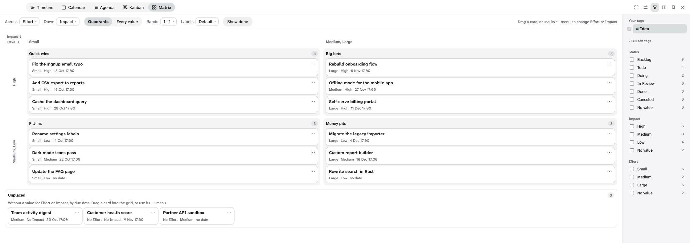

# Planner

Planner shows the nodes of any tag in a Logseq DB graph as a Timeline, a Calendar, an
Agenda, a Kanban board or a Matrix. It works with built-in tags such as #Task and with tags you create.
It runs in three places:

- **Workspace**: Planner alone on screen. On macOS it covers the whole window, app header included; Escape goes back to the page.
  On other systems it fills the window under the app header.
- **Sidebar** (desktop app): docked on the window's right edge, beside the page you are reading and beside Logseq's own right sidebar.
- **In a page**: a read-only copy of a saved view, in a block (`/Planner view`).

Version 1.3.0, checked in the Logseq desktop app (the stable 2.0.2 and nightly builds) and partly in the web app.
[Limits and known issues](docs/limits.md) says what was and was not checked.

## Requirements

- A Logseq DB graph. File graphs are not supported.
- For Timeline, Calendar and Agenda: a tag with at least one Date or DateTime property
  (its own or inherited from a parent tag). Planner never creates properties on your tags.
- For Kanban: a tag with at least one choice property (a property with a closed list of
  values, such as Status).
- For Matrix: a tag with at least two choice properties, or one choice property and a Date or DateTime
  property (When is then an axis).

## Install

**From the marketplace**: open Plugins in Logseq, open the Marketplace, search for Planner and install it.

**From a zip** (a release's `logseq-planner.zip`): unzip it, turn on Developer mode in Settings >
Advanced, open Plugins, choose Load unpacked plugin and select the unzipped `logseq-planner` folder
(the one that holds `package.json` and `dist/`).

**Unpacked, from the source**:

1. Install Node.js 22 or later.
2. In the repository folder, run `npm ci`, then `npm run build`. The build goes to `dist/`.
3. In Logseq, open Settings > Advanced and turn on Developer mode.
4. Open Plugins, choose Load unpacked plugin, and select the repository folder (the folder
   that holds `package.json`).

For development against the dev server instead, see [CONTRIBUTING.md](CONTRIBUTING.md).

## Quick start

1. Open Planner: its button in the toolbar (three staggered bars), **Planner: open** in the command palette, or `g`
   then `Shift+P`.
2. Pick a tag in the panel on the right, for example #Task or one of your own.
3. Pick a view with the tabs at the top: Timeline, Calendar, Agenda, Kanban or Matrix.
4. Narrow it in the panel: **Find** words in titles, **Added** recently, or tick filter values.
5. Keep it: **Saved views** (bookmark icon) → **Save current view**. Type `/Planner view` in a page to show it there.

Escape or **Close** goes back to the page.

## The views

- **Timeline**: one row per node, bars from Start to End with progress, from a day to a quarter, with dependency arrows.
  Drag a bar to move or resize it once Edit dates is on.
- **Calendar**: Month, Week, 3 days or Day. Drag an item to another day, or to the No date tray.
- **Agenda**: what is overdue, today and in the next 14 days, by date or by node. Drag an entry to give it a date.
- **Kanban**: a column per value of a choice property such as Status, or by When (Today, This week…), with optional
  swimlanes. Drag a card or use its ⋯ menu.
- **Matrix**: two properties as axes, such as Urgency and Importance, in four quadrants or a row and column per value.

Every view can show several tags at once, and Planner can dock on the right edge of the window beside your page.
The [guide](docs/guide.md) covers every control.

## Documentation

- [Using Planner](docs/guide.md): every view, the panel, saved views, the sidebar and the in-page block.
- [Limits and known issues](docs/limits.md): what Planner does not do, and where it was tested.
- [CHANGELOG.md](CHANGELOG.md): what changed in each version.
- [CONTRIBUTING.md](CONTRIBUTING.md): building, testing and the project tracker graph.

## Data and privacy

Planner reads, through Logseq's database queries:

- the graph's tags and their properties and closed values;
- the nodes of the tag you choose, with their title, tags and the properties Planner maps;
- the #Task blocks that reference those nodes;
- the titles of blocks that those titles link to;
- Logseq's start-of-week setting and theme values.

Planner writes four things, and nothing else:

1. **Saved views.** One block per view on the page "Plugin views: Planner", with the view's JSON in
   the hidden text property `planner-view-json` (an older "Planner views" page and `planner-view-config` property are
   renamed and moved when Planner first reads them; Planner also keeps its UI state on the hidden page "Plugin state: Planner"). Planner creates the page and the
   property when you first save.
2. **Kanban moves.** The column or swimlane property of the card you moved.
3. **Date edits.** The Start and/or End property (Scheduled and Deadline for a task) of what you moved: with Edit dates on, a
   bar or block you moved or resized in the Timeline and the Calendar's Day, 3 days and Week grids; a card moved by **When** in
   the Kanban or the Matrix; an entry dragged in the Agenda; an item dragged onto a day or the No date tray in the Calendar. For a Date
   property this can create the journal page of the new day.
4. **Its UI state.** The view on screen and the Timeline's title width, in the hidden property `planner-ui-state` of the hidden page
   "Plugin state: Planner" (it does not show in All pages or search).

Planner makes no network calls. On the desktop app it reads one file from Logseq itself, the icon font the app already loads, so that icon characters in your values draw as they do in the page.

## License

MIT. See [LICENSE](LICENSE).
