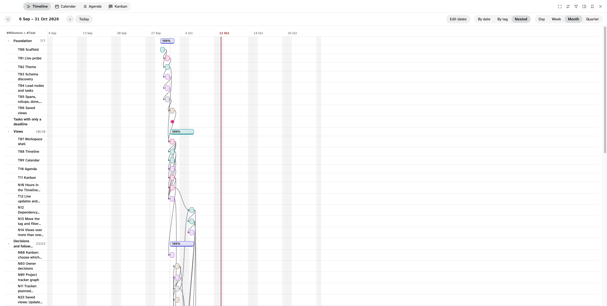
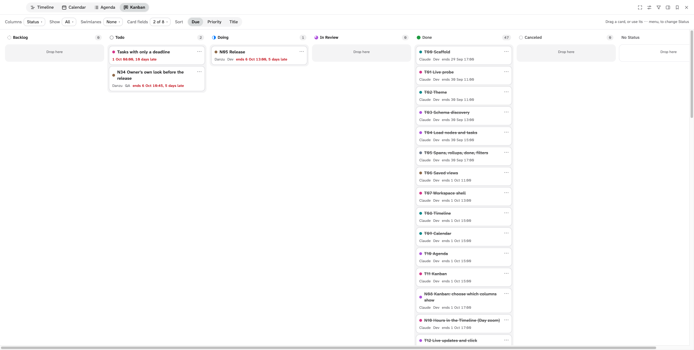

# Planner

Planner shows the nodes of any tag in a Logseq DB graph as a Timeline, a Calendar, an
Agenda or a Kanban board. It works with built-in tags such as #Task and with tags you create.
It runs in three places:

- **Workspace**: a full-window view under the app header (the window moves and resizes as usual).
- **Sidebar** (desktop app): docked over Logseq's right sidebar, beside the page you are reading.
- **In a page**: a read-only copy of a saved view, in a block (`/Planner view`).







Status: version 0.1.0, not released yet. Planner was validated in the Logseq desktop app
(Logseq-DB 2.0.1, nightly builds of 2026-10-01 and later) and partly in the Logseq web app. It
has **not** been tested in the stable Logseq.app. See [Limits and known issues](#limits-and-known-issues)
for what was and was not checked.

## Requirements

- A Logseq DB graph. File graphs are not supported.
- For Timeline, Calendar and Agenda: a tag with at least one Date or DateTime property
  (its own or inherited from a parent tag). Planner never creates properties on your tags.
- For Kanban: a tag with at least one choice property (a property with a closed list of
  values, such as Status).

## Install

**From the marketplace** (once it is listed): open Plugins in Logseq, search for Planner and install it.
It is not listed yet.

**From a zip** (a release's `logseq-planner.zip`): unzip it, turn on Developer mode in Settings >
Advanced, open Plugins, choose Load unpacked plugin and select the unzipped `logseq-planner` folder
(the one that holds `package.json` and `dist/`).

**Unpacked, from the source**:

1. Install Node.js 22 or later.
2. In the repository folder, run `npm ci`, then `npm run build`. The build goes to `dist/`.
3. In Logseq, open Settings > Advanced and turn on Developer mode.
4. Open Plugins, choose Load unpacked plugin, and select the repository folder (the folder
   that holds `package.json`).

For development against the dev server instead, see [Development](#development).

## Use

### Open and close

Open Planner in one of three ways:

- Click Planner's button in the toolbar (three staggered bars).
- Run **Planner: open** from the command palette.
- Press `g`, then `Shift+P`, while you are not editing a block.

Close it with the **Close** button or Escape. If a menu is open, Escape closes the menu
first; then, in a narrow window, an open panel drawer (see **Panel** below).

Logseq's own shortcuts (Cmd+K search, Cmd+Shift+P command palette, `t t` theme, and the rest) keep
working while Planner is open on the desktop app. Planner passes on the keys it does not use, but
not Escape, Tab, Enter, Space, the arrow keys, Home, End or Page Up / Down on their own, and not
the keys you type in a text field (Cmd+K and other non-editing Cmd / Ctrl shortcuts still pass). The web
app cannot do this: Planner's frame is a different origin there, so Logseq's shortcuts do not work while
Planner has focus. When a Logseq dialog opened this way closes (Cmd+K, then Escape), focus returns to Planner,
so its own keys work again.

### Workspace or sidebar

On the desktop app the top bar has a **Workspace | Sidebar** switch, before **Saved views**.
**Workspace** (the default) fills the window under the app header. **Sidebar** opens Logseq's
right sidebar and puts Planner in it, so the page and Planner are side by side:

- Drag Logseq's own handle on the sidebar's left edge to make Planner wider or narrower; it
  follows, and it follows the window too.
- While Planner is there it covers the sidebar's own content. Close Planner (Close, Escape or the
  toolbar button) and the sidebar's content shows again; the sidebar stays open.
- If you close Logseq's sidebar, Planner closes with it. The next time you open Planner it opens
  the sidebar again and docks in it.
- Switch back to **Workspace** for the full window; the sidebar stays as it is.

The choice lasts until Logseq reloads the plugin. In a narrow sidebar the top bar wraps and,
under 640 px, the panel is a drawer (see **Panel** below). The web app has no switch: Planner's
frame there cannot reach the sidebar.

### A Planner view in a page

Show a saved view inside any page, read-only:

1. Save the view in Planner (**Saved views** → **Save current view**).
2. In a page, type `/Planner view` and press Enter. It inserts `{{renderer :planner, }}`.
3. The caret lands after `}}`: move it two characters left, type the saved view's name, for
   example `{{renderer :planner, Milestones with tasks}}`, and leave the block.

The name is matched exactly, then ignoring case; it may contain commas. An unknown name shows
"No saved Planner view named “…”." and the names that exist. The block shows the view's name, its
tags and an **Open in Planner** button (opens Planner on that view, in the workspace), then the
view as Planner draws it, anchored on today. Click an item to open its node.

It is read-only: no toolbar, menus, filters, drag, Move menu, connectors or row toggles. Nested
Timeline children are shown open, task rows folded; long Agenda and Kanban lists end in "N more".
It redraws when the graph changes, whether Planner is open or not, and scrolls inside itself. Two
blocks of the same view load it once. Its styles apply inside the block only. It works in the
desktop and the web app.

### Choose a tag

Pick a tag in the panel on the right of the view or in the **Tag** menu. Your own tags are listed first. Built-in
tags are under **Built-in tags**, collapsed until you select one. When the tag has child tags
(tags that extend it), an **Include** checkbox adds their nodes. Planner opens on the first
of your own root tags that has date properties.

**Several tags in one view.** The checkbox before a tag in the panel adds that tag to the view
or removes it; a click on the tag's name still shows that tag alone. The view shows the nodes
of all its tags, each node once, and the **Tag** control reads, for example, "#Milestone +
#Task". The last tag cannot be unticked. A node belongs to the first ticked tag (in the order
you ticked them) that it carries, directly or through a child tag: that tag gives its dates,
its value in the **Tag** filter and its heading when the Timeline is arranged by tag.
Filters, Kanban columns and swimlanes and **Done when** offer only the properties every
ticked tag has (the same property, not just the same name), so ticking a tag can drop a filter
or a Kanban setting the tags do not share. **Depends on** offers the node properties of any
ticked tag (in a #Milestone + #Task view, #Task's `depends_on`); nodes of a tag without it
have no dependencies.

### Settings bar and filters

| Control | What it does |
|---|---|
| **Start**, **End** | The Date or DateTime properties that give a node its span. The defaults are the properties named Start and End; if the tag has none, Scheduled and Deadline; if it has none, its first date property. **End** can be set to None. |
| **Dates** | With several tags, in place of Start and End: one menu ("Dates: 2 tags") with a row per tag, each with that tag's Start and End lists and the same defaults. |
| **Depends on** | Shown when the tag (with several tags: any of them) has a node property (a property whose values are other nodes). The property that says which nodes a node depends on: None or one of them. The default is the property titled like "depends on" (`depends_on`, "Depends on", "depends-on"), else None, and it follows the view's tags until you choose one. See [Dependencies](#dependencies). |
| **Done when** | The closed values that count as done. Built-in Status uses its Done and Canceled flags. For your own choice properties, nothing is done until you tick values. |
| **Panel** | The last control in the settings bar. Hides the panel (tag tree and filters) so the view takes the full width, and shows it again. While the panel is hidden and filters are ticked, it shows how many values are ticked, for example **Panel · 2**. Planner keeps the choice until Logseq restarts. When Planner is narrower than 640 px, the panel starts closed and opens as a drawer over the view; Escape or a click on the view closes it. |
| Filters (panel) | Tick values of the tag's choice properties to narrow the nodes. Nothing ticked means no filter. **No value** matches nodes without a value. With several tags, a **Tag** group comes first: tick tags to show only their nodes. |

How a node gets its dates:

- Start and End both set: a span.
- One date: a point.
- No Start or End, but linked tasks with Scheduled or Deadline dates: a span derived from
  those tasks, drawn dashed. When all of its tasks fall on one date and time, the span reads as that one
  date ("9 Oct 09:00 from its tasks"), not as a range.
- No date at all: listed apart from the grid.

A #Task block belongs to a node when it references the node, either as an inline link or in
a node property. A node's progress is done tasks divided by all its tasks minus canceled
ones. When #Task is one of the view's tags, a task is its own row and is not listed again
under the node it references; it still counts in that node's progress.

### Dependencies

With a **Depends on** property set, a node that points to another node through it depends on
that node; it is not one of its tasks. For example, when T08 has `depends_on: T07`, T08 does
not count in T07's progress and is not one of T07's task rows, in every view. Its other
references still link it as before. With **Depends on** set to None, every reference links.

### Views

Switch views with the buttons in the top bar. The view toolbar sits above the view. The
previous and next buttons and **Today** move the period.

**Timeline.** One row per node, sorted by start, with a progress strip on each bar.

- **Zoom**: Day (one day, 24 hour columns), Week (21 day columns), Month (56 day columns),
  Quarter (17 week columns).
- **Day** zoom places DateTime spans by their times, to the quarter hour. A Date-only span
  covers the whole day; a span that runs past midnight is cut off at the edge and marked.
  Task markers sit at their time. The today line marks the current time. The view opens
  scrolled to the first timed item of the day, or to 08:00.
- Derived spans are dashed. One-date nodes are diamonds. A today line marks the current day.
  A bar cut off at the edge of the range is marked.
- Nodes with tasks expand into task rows with Scheduled and Deadline markers. A task is late
  when it is open and its due date, the Deadline or else the Scheduled date, is before today;
  the marker of that date turns red.
- With a **Depends on** property, a line with an arrow runs from the end of each dependency's
  bar to the start of its dependent's (both must be in the range). A bar's tooltip and label
  name what it depends on.
- Only nodes that touch the range get a row. A line above the grid counts the others, for
  example "412 earlier · 1,105 later". Each side is a button that moves to the nearest such
  node.
- **Arrange** (with several tags): **By date**, one list sorted by start; **By tag**, a
  heading row per tag in the order you ticked them, then that tag's rows by start; or
  **Nested** (the default with several tags): a node that references another node of the view
  (a task whose Milestone property points to its milestone) is a row of its own under it,
  indented, with its own bar. The parent's count is its children plus its other tasks. A
  parent starts open; its toggle hides its rows until you open it again (until Logseq
  restarts). Nesting is one level deep: a grandchild is listed as a top-level row. A node
  referencing several nodes goes under the first of them in row order; two nodes referencing
  each other: the later one goes under the earlier. A reference through the **Depends on**
  property does not nest.

**Calendar.** All-day items only.

- **Layout**: Month or Week. Month shows the whole weeks of the anchor's month.
- Span nodes are bands that keep the same lane across weeks. One-date nodes and the
  Deadline of linked tasks are chips, red when the task is late. Scheduled dates are not shown.
- Month shows three item rows per day, then **+N more**, which opens that week.
- Week lists items by time and shows the time of DateTime values.
- The first day of the week follows Logseq's start-of-week setting.

**Agenda.** A list of what is overdue and what is coming. A task is overdue when it is late
(open, and its Deadline, or its Scheduled date when it has no Deadline, is before today); it
sorts at that date and shows how many days late.

- **Group by**: Date or Node.
- By date: Overdue, Today, each of the next 14 days, then **Later**, **No date** and
  **Earlier**. The last three are folded and render when opened. Empty buckets are omitted.
  Overdue renders its first 100 entries; **Show 100 more of N** adds the next 100 (its
  heading keeps the real total).
- By node: one panel per node with its progress and tasks, overdue first. The first 100
  groups render; **Show 100 more of N** adds the next 100. With several tags, a child node
  (as in the Timeline's Nested) is listed in its parent's panel, not in a panel of its own.
- **Show done** includes done and canceled entries (within 14 days, or under No date).

**Kanban.** A board of cards.

- **Columns**: a choice property (Status by default). Each closed value is a column, plus
  "No <property>".
- **Show**: which columns show. Untick a value (or "No <property>") and its column and
  cards leave the board; the button reads **All** or, for example, **3 of 7**. At least one
  column stays shown. The choice is kept per column property, so switching **Columns** to
  another property and back keeps it. The ⋯ menu still lists every value: moving a card to a
  hidden column takes it off the board.
- **Swimlanes**: None, or a second choice property. It adds a lane per value, plus
  "No <property>". With several tags, **Tag** gives a lane per tag; these lanes are
  read-only: a card cannot be dropped into another tag's lane, and its ⋯ menu lists columns only.
- **Sort**: Due, Priority (offered only when the tag has a Priority property) or Title.
  There is no manual order.
- Each cell shows its first 50 cards, then **Show 50 more of N**. The counts in the headers
  are the real totals.

Click a card, bar, chip or entry to open the node in the main area. Planner hides. Shift+click
opens the node in the right sidebar and Planner stays open.

### Move a card

Drag a card to another cell, or use the card's **⋯** menu (Move) with the keyboard. Use the
menu to reach a column that is scrolled out of view.

A move writes to the node:

- To another column: sets the column property to that value.
- To another lane: sets the swimlane property to that value.
- To "No <property>": removes the value.

The card shows the new place at once and cannot be dragged while the write runs. Planner then
reads the value back from the graph. If the graph does not hold it, the card returns to its
column and an error shows in the error bar. Undo in Logseq reverted a move in the live test.

### Edit dates in the Timeline

Turn on **Edit dates** in the Timeline toolbar. It is off whenever Planner starts and is not saved with a view. It
works in the workspace and in the sidebar, never in a Planner view inside a page.

- Drag a bar to move it: its Start and End move by the same number of days (15 minutes in Day zoom).
- Drag the first or last few pixels of a bar to change that date only. A bar keeps at least one day (one quarter hour
  in Day zoom), and its start cannot pass its end.
- Drag a diamond (a node with one date) to move that date.
- With a bar or diamond focused (Tab), **Alt+Left** and **Alt+Right** move it by one day (15 minutes in Day zoom);
  **Alt+Shift+Left** and **Alt+Shift+Right** change its End (its Start when only the Start can change).
- **Escape** during a drag puts the bar back and writes nothing. A click (a move of less than 4 pixels) still opens
  the node.

A DateTime value keeps its time of day when it moves by days. A Date value is set to that day's journal page, so moving
to a day without a journal page creates the page.

Not editable (no handles, normal cursor): bars dashed because their dates come from their tasks, task markers, and
Date values in Day zoom (a day cannot move by 15 minutes). A bar cut off at the edge of the range cannot be resized on
that edge; zoom out or move the range to reach it. Only the node's own Start and End are written; a parent's dates,
rollups and connectors follow from the data after the write.

The bar shows its new place at once and is dimmed while Planner writes it. Planner then reads the dates back from the
graph. If they differ, the bar returns to where the graph has it and the error bar says why; when only the second of
two dates failed, the first is put back and the error says whether that worked. Whether Logseq's undo reverts a date
edit has not been checked.

### Saved views

**Saved views** (top bar) lists, opens and deletes saved views. **Save current view** saves
a new view under the name in the Name field. With a saved view open, **Update "name"** stores the
current settings in that view, under the same name. **×** asks first: the row turns into
**Delete "name"?** with **Cancel** and **Delete**. In this menu, and in **Done when** and the
Kanban **Show** menu, Arrow Up and Down move through the entries. A saved view stores the tags, child tags, each tag's Start and End,
done values, filters and the view settings: Timeline zoom and arrangement, Calendar layout, Agenda Group by
and Show done, Kanban columns, shown columns, swimlanes and sort. It does not store the period you are
looking at.
A name loses the characters `#`, `[`, `]`, `{` and `}`, and runs of `(` or `)` become one, so
Logseq cannot turn it into a tag, a link, a macro or a block ref ("#Project kanban" is saved as
"Project kanban"). A saved view whose stored settings cannot be read is listed greyed with the
reason; it cannot be opened, only deleted.

### Live refresh

The open view redraws after graph changes. It keeps your scroll position, expanded rows,
unfolded Agenda buckets and focus. It waits while a menu is open, a card or a Timeline bar is being dragged, or a
write is running.
When you open another graph in the same Logseq session, Planner loads the new graph and opens it as you left
it (see below); a graph you never used opens with the default view, and the surface stays as it is.

Planner remembers, per graph: the view on screen (tags, kind and settings, and the saved view it belongs to),
whether the side panel is open, Workspace or Sidebar, and Edit dates. This is kept in the plugin's settings on
this device, not in the graph, so it does not sync. The period you are looking at and expanded rows are not
remembered.
Planner also checks the graph every 30 seconds while it is visible. While hidden, it only
notes that data may be stale and reloads once when you open it again.

### Theme

Planner follows the active Logseq theme and light or dark mode. Where Logseq exposes no
value (status colors, today color), it uses the Inkwell defaults in
[docs/design.md](docs/design.md).

## Data and privacy

Planner reads, through Logseq's database queries:

- the graph's tags and their properties and closed values;
- the nodes of the tag you choose, with their title, tags and the properties Planner maps;
- the #Task blocks that reference those nodes;
- the titles of blocks that those titles link to;
- Logseq's start-of-week setting and theme values.

Planner writes three things, and nothing else:

1. **Saved views.** One block per view on the page "Planner views", with the view's JSON in
   the hidden string property `planner-view-config`. Planner creates the page and the
   property when you first save.
2. **Kanban moves.** The column or swimlane property of the card you moved.
3. **Timeline date edits** (only with Edit dates on). The Start and/or End property of the bar you moved or resized.
   For a Date property this can create the journal page of the new day.

Planner makes no network calls.

## Limits and known issues

These come from the progress log in [tasks.md](tasks.md) and the results in
[docs/manual-test.md](docs/manual-test.md).

**Scope**

- Planner writes only Kanban moves and, with Edit dates on, Timeline date edits. Calendar, Agenda and the in-page view
  never edit dates.
- Edit dates was checked live on the desktop app (move and resize of a DateTime and a Date span, Day zoom, Escape,
  Alt+Arrow keys). Not checked: a diamond, a failed write, the sidebar surface, the block staying read-only (unit-tested
  only), Logseq's Undo after an edit, and pointer capture when the pointer leaves the frame.
- No view defined by a free query, no filters per tag. No day view or hour grid in the Calendar (the Timeline has a Day zoom),
  no year zoom in the Timeline, no manual card order in Kanban, no Agenda range other than 14 days.
- The sidebar surface is desktop only. It was checked live there, but with in-app clicks: not a real-mouse drag of
  Logseq's sidebar handle, not the narrow drawer while docked, and not the web app (which shows no switch).
- The in-page block was checked live on the desktop app, but not the slash command (the caret lands after `}}`), the
  host's page styles outside the block (beyond one font size), clicks on a bar or a Kanban card, Open in Planner while
  docked, Logseq's default themes, or the web app.

**Where it was tested**

- Desktop app: Logseq-DB 2.0.1 nightly builds (2026-10-01 and later), on CLI-seeded persisted graphs. The checks were the
  focused desktop pass in docs/manual-test.md, the sidebar and in-page block rows, and Edit dates. Most of the older
  checklist rows (sections A to J) were run in the Logseq web app dev build of 2026-09-02 (checkout `d2ab7726ab`) on an
  in-memory test graph in headless Chrome, and not repeated on the desktop.
- The **stable Logseq.app was not tested**, and neither was any Logseq build other than those two.
- Real mouse clicks were checked on the desktop top bar only after the first desktop pass failed on them (fixed); later
  passes mostly used in-app clicks over CDP because the window could not be brought to the front.
- Sync is untested. Changes that arrive by sync are caught by the 30-second check, not by an event. A second desktop
  window on the same graph refreshes within about 2.5 s. `DB.onChanged` was seen firing for local edits, another
  browser tab, the plugin's own writes and undo.
- Switching graphs in one session is covered by unit tests only; the fix has not been re-run live.
- Dragging to a Kanban column that is scrolled out of view did not register in the web test tool (it passes on the
  desktop through auto-scroll), and dragging from the card's button in Firefox was not checked. Use the Move menu.
- Logseq's default dark theme was checked on the Timeline only. VoiceOver was not tried.
- In docs/manual-test.md, some rows are marked partial or not run; the file lists them.

**Behavior**

- Deleting a tag does not trigger a refresh. The tag stays listed until the next graph change
  or the 30-second check. Planner then falls back to the default view and shows a message.
  A created tag appears at once.
- If the page "Planner views" is in Recycle, saving fails with a message. Restore the page or
  delete it in Recycle (More menu), then save again. Planner does not restore it for you.
- Reopening Planner after it was hidden with stale data runs two reloads; the second changes
  nothing.
- A Date property value that points at no journal page (for example a value Logseq left as
  its empty placeholder) counts as no value.
- Nodes and tasks in Recycle, or on a page in Recycle, are not shown.
- A choice property that allows several values is not offered for filters, Kanban or done
  values.

**Large tags**

Measured on one tag with 2,000 nodes and about 2,000 linked tasks, in the web app, dev
build, headless Chrome (T13a, after commit 4d45a0b):

| Measure | Result |
|---|---|
| First load | 326 to 350 ms (target: under 1 s) |
| Live refresh (`refresh.totalMs`, five edits per view) | Timeline 179 to 184 ms, Calendar 165 to 169 ms, Agenda 169 to 179 ms, Kanban 181 to 186 ms (two Timeline runs at 260 ms) |
| End of a write to the redraw | about 215 to 235 ms with the 50 ms debounce, with occasional runs near 310 ms (target: under 300 ms) |

On the desktop app (production build, 2,000 nodes) a tag switch took 351 ms to the first paint and a Kanban refresh
294 to 373 ms (over the 300 ms target on 4 of 5 runs). A graph where few tasks link the tag was not measured.

## Development

```bash
npm ci
npm run dev        # Vite dev server on http://localhost:8293 (--strictPort); removes dist/ first
npm run preview    # serves the build on http://localhost:8294 (--strictPort)
npm run typecheck  # tsc --noEmit
npm test           # Vitest, src/**/*.test.ts and scripts/**/*.test.mjs
npm run build      # production build into dist/
npm run probe      # live probe and seeds; see docs/probes.md
npm run tracker    # mirror tasks.md into the planner-project graph (see below)
```

Load the dev server in Logseq with Settings > Advanced > Developer mode, then Plugins >
Load plugin from web url > `http://localhost:8293/`.

`npm run probe` drives a Logseq web app that is already open and refuses any graph other than
`plugin-test` or `Demo`. Options:

- `--seed`: import the small seed (`scripts/seed.edn.mjs`).
- `--seed-large [N]`: import the load-test seed of N nodes, 2,000 by default
  (`scripts/seed-large.edn.mjs`).
- `--writes`, `--other-window`: record write and multi-window behavior.
- `--timings`: print the dev-only load and refresh timings.

Tests sit next to the code as `src/**/*.test.ts`. The pure core runs in Node. DOM tests start
with `// @vitest-environment happy-dom`. SDK calls are injected, so tests pass fakes, and
core tests use the probe fixtures in `src/core/__fixtures__/`.

Conventions (from [CLAUDE.md](CLAUDE.md)):

- One item of [tasks.md](tasks.md) per change. Write its acceptance test first.
- Commit subjects are `feat|fix|docs(...): summary (Tnn)`. Docs go in the same commit as the
  code.
- `npm run typecheck`, `npm test` and `npm run build` pass before every commit.
- Live checks use the `plugin-test` graph only.

Further reading:

- [ARCHITECTURE.md](ARCHITECTURE.md): the code map, data flow and design decisions.
- [REQUIREMENTS.md](REQUIREMENTS.md): scope and acceptance criteria.
- [docs/design.md](docs/design.md): visual design and theme tokens.
- [docs/probes.md](docs/probes.md): what the live probe observed about the Logseq API.
- [docs/manual-test.md](docs/manual-test.md): the end-to-end checklist and its results.

## Project tracker graph

`npm run tracker` mirrors this repository's task list into a Logseq DB graph, so Planner has
real project data: one `#Project` (Planner), one `#Milestone` per group of tasks, and one
`#Task` per item of [tasks.md](tasks.md) (id in the title, Status from the checkbox, Team,
Owner, Milestone, depends_on). **tasks.md is the source of truth; the graph is a copy.** Run it
after each task; it only writes differences, so a second run changes nothing. Groups, team and
owner overrides live in `scripts/tracker-meta.json`; a task in tasks.md that is in no milestone
stops the run.

**Start, End and Scheduled are a planned schedule, not history.** Every task gets 2 hours and
starts after the tasks it depends on, so dates before today are planned values, not the time the
work happened. The rule:

- Order: tasks with at least one commit naming `(ID)` come first, by first-commit time (ties by
  id), then the others by id (T before N, numeric). Commit times only order the tasks and set
  Doing; they are never written as dates.
- Dependency: a task without an entry in `after` depends on the previous one in that order (the
  first has none). A task starts at the latest End of its dependencies, so dependencies only set
  the earliest start: tasks with no dependency between them overlap (no resource limit).
  "depends_on" holds all of a task's dependency blocks (node property, cardinality many).
- Working time: weekdays 09:00-17:00 local time. A start outside it (before 09:00, at or after
  17:00, a weekend) moves to the next working moment; a task that would pass 17:00 continues the
  next working day at 09:00.
- Graph values: task Start = scheduled start, End = scheduled end, Scheduled = Start (epoch ms of
  the local time). A milestone's Start / End = earliest Start / latest End of its tasks; the
  project's Start = the first task's Start (no End). Backlog tasks are scheduled like any other.

Meta keys (`scripts/tracker-meta.json`): `scheduleStart` (`"2026-09-25T15:00"`, local time without
zone; a fixed constant, never taken from the clock, so a rerun gives the same dates), `taskHours`
(2), optional `"hours": {"N05": 4}` per task and `"after": {"N05": ["N04", "N03"]}` (ids) to
replace the default dependency; `"after": {"T00": []}` means no dependency (starts at
`scheduleStart`). Every current task has an entry. An `after` naming an unknown id, or a
dependency cycle, stops the run. `scheduleStart` is chosen so the last committed task ends Fri
2 Oct 2026 17:00.

The CLI cannot create a node-typed property, so "depends_on" comes from the EDN the graph is
created with: a graph made before N11 lacks it and the run says so; remove it
(`logseq graph remove -g planner-project`, with no app holding it) and run again.

```bash
npm run tracker                       # graph planner-project (created on the first run)
npm run tracker -- --graph <name>     # another graph
npm run tracker -- --dry-run          # print the CLI calls, write nothing
```

It drives the `logseq` CLI (no shell) and checks the CLI revision first (`--revision`, default
`8ffbb22`). The graph is created and imported once; later changes use `logseq upsert`, so they
work while the desktop app has the graph open. Logic and CLI shapes: `scripts/tracker-lib.mjs`,
`scripts/tracker.mjs`.

## License

MIT. See [LICENSE](LICENSE).
