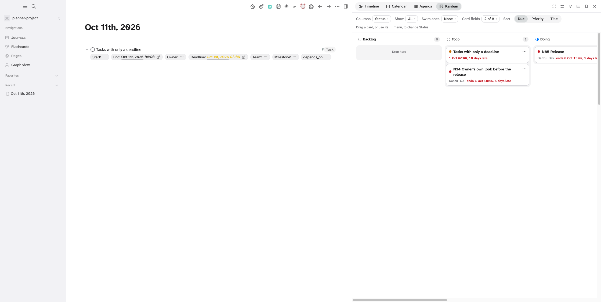
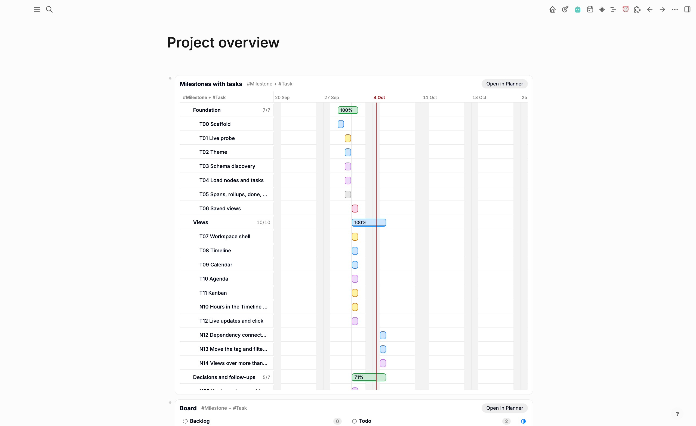
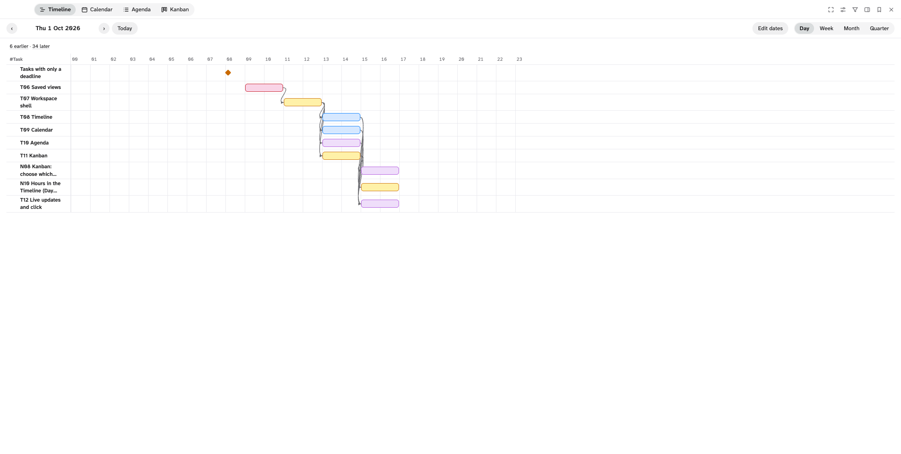
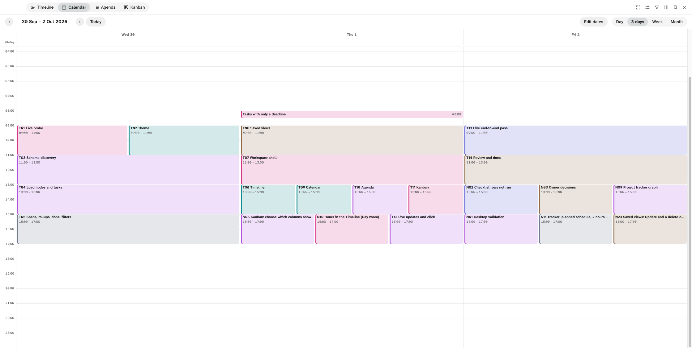

# Using Planner

The full guide to Planner's views and controls. For what Planner needs and how to install it, see the
[README](../README.md); for what was and was not checked, [Limits and known issues](limits.md).

## Open and close

Open Planner in one of three ways:

- Click Planner's button in the toolbar (three staggered bars).
- Run **Planner: open** from the command palette.
- Press `g`, then `Shift+P`, while you are not editing a block.

Close it with the **Close** button or Escape. If a menu is open, Escape closes the menu
first; then, in a narrow window, an open panel drawer (see **Panel** below).

Logseq's own shortcuts (Cmd+K search, Cmd+Shift+P command palette, `t t` theme, and the rest) keep
working while Planner is open on the desktop app. Planner passes on the keys it does not use, but
not Escape, Tab, Enter, Space, the arrow keys, Home, End or Page Up / Down on their own, and not
the keys you type in a text field (Cmd+K and other non-editing Cmd / Ctrl shortcuts still pass). The web
app cannot do this: Planner's frame is a different origin there, so Logseq's shortcuts do not work while
Planner has focus. When a Logseq dialog opened this way closes (Cmd+K, then Escape), focus returns to Planner,
so its own keys work again.

## Workspace or sidebar

The top bar has six icon buttons at the right, each named by its tooltip: **Focus**, **View settings**, **Panel**, a dock
button, **Saved views** and **Close**. In a narrow frame (under 480 px) they wrap to a second row under the view tabs.

On the desktop app the dock button switches between the two places. It reads **Dock to the right** in the workspace and
**Back to the workspace** when docked.

- **Workspace** (the default) is Planner alone. On macOS it covers the app header too, because the header's controls would
  act on the page behind Planner. The window buttons sit at the top left, so Planner's top row starts after them; the strip
  above Planner no longer moves the window (move it by its edge). Escape or **Close** returns to the page.
- **Sidebar** docks Planner on the right edge of the window, from the very top on macOS. Logseq's own right sidebar opens
  beside it and neither moves the other: Planner reserves its strip in the layout, so the page and Planner are side by side.

When docked:

- Drag the handle on Planner's left edge to make it wider or narrower (double-click: 40% of the window; the arrow keys also
  work). The width is remembered on this device.
- Clicking a node opens it in the page and keeps Planner open. In the workspace a click opens the node and hides Planner;
  Shift+click opens it in Logseq's right sidebar and keeps Planner open in both places.
- Closing Planner (**Close**, Escape or the toolbar button) gives the strip back. The place you chose is kept.
- If another plugin is docked on the right edge too (such as Outline Canvas with the same dock-order contract,
  [docs/dock-order.md](dock-order.md)), Planner docks beside it instead of over it, and follows it when it resizes or hides.

The place you chose is remembered per graph. The web app has no dock button: Planner's frame there cannot reach the host.

**Focus** hides the top bar, settings and view toolbar behind a one-line strip that names the view; its button brings them back.

## A Planner view in a page

Show a saved view inside any page, read-only:

1. Save the view in Planner (**Saved views** → **Save current view**).
2. In a page, type `/Planner view` and press Enter. It inserts `{{renderer :planner, }}`.
3. The caret lands after `}}`: move it two characters left, type the saved view's name, for
   example `{{renderer :planner, Milestones with tasks}}`, and leave the block.

The name is matched exactly, then ignoring case; it may contain commas. An unknown name shows
"No saved Planner view named “…”." and the names that exist. The block shows the view's name, its
tags and an **Open in Planner** button (opens Planner on that view, in the workspace), then the
view as Planner draws it, anchored on today. Click an item to open its node.

It is read-only: no toolbar, menus, filters, drag, Move menu, connectors or row toggles. Nested
Timeline children are shown open, task rows folded; long Agenda and Kanban lists end in "N more".
It redraws when the graph changes, whether Planner is open or not, and scrolls inside itself. Two
blocks of the same view load it once. Its styles apply inside the block only. It works in the
desktop and the web app.

## Choose a tag

Pick a tag in the panel on the right of the view or in the **Tag** menu. In the panel, **Tags** shows the view's
tags; unfold it for the full list, with a **Find a tag** field that narrows it and counts what is left. Your own tags
are under **Your tags**; built-in ones under **Built-in tags**, folded until you select one. When the tag has child tags
(tags that extend it), an **Include** checkbox adds their nodes. Planner opens on the first
of your own root tags that has date properties.

**Several tags in one view.** The checkbox before a tag in the panel adds that tag to the view
or removes it; a click on the tag's name still shows that tag alone. The view shows the nodes
of all its tags, each node once, and the **Tag** control reads, for example, "#Milestone +
#Task". The last tag cannot be unticked. A node belongs to the first ticked tag (in the order
you ticked them) that it carries, directly or through a child tag: that tag gives its dates,
its value in the **Tag** filter and its heading when the Timeline is arranged by tag.
Filters, Kanban columns and swimlanes and **Done when** offer only the properties every
ticked tag has (the same property, not just the same name), so ticking a tag can drop a filter
or a Kanban setting the tags do not share. **Depends on** offers the node properties of any
ticked tag (in a #Milestone + #Task view, #Task's `depends_on`); nodes of a tag without it
have no dependencies.

## Settings bar and filters

The **View settings** button (sliders icon) in the top bar opens the settings bar below it, which starts folded.

| Control | What it does |
|---|---|
| **Start**, **End** | The Date or DateTime properties that give a node its span. The defaults are the properties named Start and End; if the tag has none, Scheduled and Deadline; if it has none, its first date property. **End** can be set to None. |
| **Dates** | With several tags, in place of Start and End: one menu ("Dates: 2 tags") with a row per tag, each with that tag's Start and End lists and the same defaults. |
| **Depends on** | Shown when the tag (with several tags: any of them) has a node property (a property whose values are other nodes). The property that says which nodes a node depends on: None or one of them. The default is the property titled like "depends on" (`depends_on`, "Depends on", "depends-on"), else None, and it follows the view's tags until you choose one. See [Dependencies](#dependencies). |
| **Done when** | The closed values that count as done. Built-in Status uses its Done and Canceled flags. For your own choice properties, nothing is done until you tick values. |
| **Panel** (funnel icon, top bar) | Hides the panel (tag tree and filters) so the view takes the full width, and shows it again. While the panel is hidden and filters are ticked, a badge on the button shows how many values are ticked, for example 2. Planner keeps the choice until Logseq restarts. When Planner is narrower than 640 px, the panel starts closed and opens as a drawer over the view; Escape or a click on the view closes it. |
| Panel layout | The top of the panel stays put while the rest scrolls: a status line while anything narrows the view ("4 of 14 nodes", with **Clear all**), **Find** and **Added**. Under it, **Tags** and one group per filter. Every heading but Find folds, marked like a Logseq block: a bullet, with a halo while folded. A folded heading names what is on in it, for example "Added · Last 7 days" or "Priority · High", and while you scroll the heading of the list you are in stays at the top. Added and Tags start folded. In the narrow drawer the whole panel scrolls as one. |
| Find and Added (panel) | **Find** keeps the nodes and tasks with every word you type in their title. **Added** keeps what was created **Today** or in the **Last N days** (7 to start, 1 to 365; the date a node or task was created, not when it last changed, since moving a card changes it). A node shows when it matches, or when one of its tasks does: then only those tasks are listed under it. While either is on, the status line at the top of the panel counts the nodes left, with **Clear all**; with the panel hidden, the Panel button's tooltip says it. Both are saved with a view; a saved "Last 7 days" always means the 7 days before the day you open it. |
| Filters (panel) | Tick values of the tag's choice properties to narrow the nodes. Nothing ticked means no filter. **No value** matches nodes without a value. With several tags, a **Tag** group comes first: tick tags to show only their nodes. |

How a node gets its dates:

- Start and End both set: a span.
- One date: a point.
- No Start or End, but linked tasks with Scheduled or Deadline dates: a span derived from
  those tasks, drawn dashed. When all of its tasks fall on one date and time, the span reads as that one
  date ("9 Oct 09:00 from its tasks"), not as a range.
- No date at all: listed apart from the grid.

A #Task block belongs to a node when it references the node, either as an inline link or in
a node property. A node's progress is done tasks divided by all its tasks minus canceled
ones. When #Task is one of the view's tags, a task is its own row and is not listed again
under the node it references; it still counts in that node's progress.

## Dependencies

With a **Depends on** property set, a node that points to another node through it depends on
that node; it is not one of its tasks. For example, when T08 has `depends_on: T07`, T08 does
not count in T07's progress and is not one of T07's task rows, in every view. Its other
references still link it as before. With **Depends on** set to None, every reference links.

## Views

Switch views with the buttons in the top bar. The view toolbar sits above the view. The
previous and next buttons and **Today** move the period.

**Timeline.** One row per node, sorted by start, with a progress strip on each bar.

- **Zoom**: Day (one day, 24 hour columns), Week (21 day columns), Month (56 day columns),
  Quarter (17 week columns).
- **Day** zoom places DateTime spans by their times, to the quarter hour. A Date-only span
  covers the whole day; a span that runs past midnight is cut off at the edge and marked.
  Task markers sit at their time. The today line marks the current time. The view opens
  scrolled to the first timed item of the day, or to 08:00.
- Derived spans are dashed. One-date nodes are diamonds. A today line marks the current day.
  A bar cut off at the edge of the range is marked.
- Nodes with tasks expand into task rows with Scheduled and Deadline markers. A task is late
  when it is open and its due date, the Deadline or else the Scheduled date, is before today;
  the marker of that date turns red.
- With a **Depends on** property, a line with an arrow runs from the end of each dependency's
  bar to the start of its dependent's (both must be in the range). A bar's tooltip and label
  name what it depends on.
- Only nodes that touch the range get a row. A line above the grid counts the others, for
  example "412 earlier · 1,105 later". Each side is a button that moves to the nearest such
  node.
- **Arrange** (with several tags): **By date**, one list sorted by start; **By tag**, a
  heading row per tag in the order you ticked them, then that tag's rows by start; or
  **Nested** (the default with several tags): a node that references another node of the view
  (a task whose Milestone property points to its milestone) is a row of its own under it,
  indented, with its own bar. The parent's count is its children plus its other tasks. A
  parent starts open; its toggle hides its rows until you open it again (until Logseq
  restarts). Nesting is one level deep: a grandchild is listed as a top-level row. A node
  referencing several nodes goes under the first of them in row order; two nodes referencing
  each other: the later one goes under the earlier. A reference through the **Depends on**
  property does not nest.

**Calendar.** Month, or a time grid for a day, three days or a week.

- **Layout**: Day, 3 days (yesterday, today and tomorrow around the anchor; the arrows move three days), Week or Month.
  The first day of the week follows Logseq's start-of-week setting.
- **Month** shows the whole weeks of the anchor's month. Span nodes are bands that keep the same lane across weeks. One-date
  nodes and the Deadline of linked tasks are chips, red when the task is late. Scheduled dates are not shown. It shows three
  item rows per day, then **+N more**, which opens that week.
- **Day, 3 days and Week** are time grids of 24 hours, opening around the current time. Items with a time are blocks placed by
  their minutes (a point or deadline is a 30-minute block, drawn on one line; overlapping blocks sit side by side); items
  without a time are in the all-day row, spans as bands. Tasks' Scheduled and Deadline dates are shown too. A line marks now.
- With **Edit dates** on, drag a block to move it (to another day or time, in 15-minute steps), drag its top or bottom edge to
  change its start or end, or use Alt+Arrow keys (Alt+Shift+Up and Down change the end). Each edit is written and read back.
- **Drag to a day**: in Month, drag a band or chip onto another day; the day you picked it up by lands there and its other
  dates move with it (a span keeps its length, a DateTime its time). In the grids, drag an all-day band or chip onto another
  day's heading or all-day cell. The **No date** tray under the calendar lists the items without a date, the newest first: drag one onto a day to
  give it that day (its End, else its Start; a DateTime at 00:00), or drop a dated item on the tray to remove its dates. Each
  write is read back and undone on failure.

**Agenda.** A list of what is overdue and what is coming. A task is overdue when it is late
(open, and its Deadline, or its Scheduled date when it has no Deadline, is before today); it
sorts at that date and shows how many days late.

- **Group by**: Date or Node.
- By date: Overdue, Today, each of the next 14 days, then **Later**, **No date** and
  **Earlier**. The last three are folded and render when opened. Empty buckets are omitted.
  Overdue renders its first 100 entries; **Show 100 more of N** adds the next 100 (its
  heading keeps the real total).
- By node: one panel per node with its progress and tasks, the newest first (a node is as new as its newest task),
  then overdue first. A task linked to
  several nodes is listed under each of them (by date it is listed once). The first 100
  groups render; **Show 100 more of N** adds the next 100. With several tags, a child node
  (as in the Timeline's Nested) is listed in its parent's panel, not in a panel of its own.
- **Show done** includes done and canceled entries (within 14 days, or under No date).
- **Drag an entry** to give it a date. While you drag, a strip at the top offers Today, Tomorrow,
  This week, Next week, This month, This quarter and No date (the Kanban's When periods); by date,
  the Today and day headings take a drop too, for that exact day. The rules are the Kanban's by
  When: a period writes its last day, a node with Start and End keeps its length, a DateTime keeps
  its time, No date removes the dates. A task block moves its Deadline (and its Scheduled date by
  the same days); one with only a Scheduled date moves that.

**Kanban.** A board of cards.

- **Columns**: a choice property (Status by default). Each closed value is a column, plus
  "No <property>". Or **When**: the view's dates in periods, Overdue, Today, Tomorrow, This
  week, Next week, This month, This quarter, Later, No date (weeks follow Logseq's week start;
  a period with no days left is left out). Done cards are left out and counted. Overdue and No date list the newest
  first, whatever the Sort.
- **Show**: which columns show. Untick a value (or "No <property>") and its column and
  cards leave the board; the button reads **All** or, for example, **3 of 7**. At least one
  column stays shown. The choice is kept per column property, so switching **Columns** to
  another property and back keeps it. The ⋯ menu still lists every value: moving a card to a
  hidden column takes it off the board.
- **Swimlanes**: None, or a second choice property. It adds a lane per value, plus
  "No <property>". With several tags, **Tag** gives a lane per tag; these lanes are
  read-only: a card cannot be dropped into another tag's lane, and its ⋯ menu lists columns only.
- **Sort**: Due, Priority (offered only when the tag has a Priority property) or Title.
  There is no manual order.
- Each cell shows its first 50 cards, then **Show 50 more of N**. The counts in the headers
  are the real totals.

**Matrix.** A priority matrix: two choice properties of the tag as axes, such as Urgency and Importance
(Eisenhower) or Effort and Impact. Use it to triage: cards without a value wait under the grid until you place them.

- **Across** and **Down**: the two properties. A new view picks Urgency and Importance, or Effort (or Size) and
  Impact (or Value), when the tag has properties with those names; otherwise Priority goes down and **When** goes
  across when the tag has a Date or DateTime property, else the next choice property. Picking the property the other
  axis uses swaps the axes.
- **When** as an axis: the periods of the Kanban's When columns (Overdue to Later), by the card's due date. Its first
  band runs to the end of this week ("Overdue – This week"), the second after it. A move into a When band gives the
  card the band's last day that takes one (the end of this week, or of the quarter), as a Kanban move by When; a card
  already in that band keeps its date. In Every value, Overdue and Later take no move. Cards without a date are
  Unplaced. With Priority (or Importance) down, the quadrants take Eisenhower's labels.
- **Quadrants** splits each axis into two bands; **Every value** gives a row and a column per value. Its columns
  narrow to 130 px before the grid scrolls sideways, so about seven values fit a full window; a long title wraps in
  its card rather than widening the columns.
- **Show** (Every value): untick values to take their rows or columns out of the grid, with their cards ("2 in
  hidden values"). One value per axis always stays. Saved with the view, per property.
- **Bands**: per axis, **Reverse** flips the order of its values, and **−** / **+** move the split. A new view puts
  the smaller half first when a property has an odd number of values. Priority starts reversed, Urgent first. A
  value added to the property later joins the second band.
- **Labels**: rename the four quadrants. An empty name shows the default: "Do first", "Schedule", "Delegate",
  "Eliminate" for Urgency and Importance; "Quick wins", "Big bets", "Fill-ins", "Money pits" for Effort and
  Impact; otherwise the values of the two bands. Quadrants have no colour of their own.
- **Unplaced**, under the grid: the cards that lack a value on either axis, the newest first.
- **Show done** includes done and canceled cards; otherwise the toolbar says how many are hidden.
- Each cell shows its first 50 cards, then **Show 50 more of N**. Under 640 px the cells stack in one column.

Click a card, bar, chip or entry to open the node in the main area. Planner hides. Shift+click
opens the node in the right sidebar and Planner stays open.

## Move a card

Drag a card to another cell, or use the card's **⋯** menu (Move) with the keyboard. Use the
menu to reach a column that is scrolled out of view.

A move writes to the node:

- To another column: sets the column property to that value.
- To another lane: sets the swimlane property to that value.
- To "No <property>": removes the value.

The card shows the new place at once and cannot be dragged while the write runs. Planner then
reads the value back from the graph. If the graph does not hold it, the card returns to its
column and an error shows in the error bar. Undo in Logseq reverted a move in the live test.

With columns by **When**, a move gives the card a date: the last day of the period ("due by"), and a card already in
that period keeps its date. A node with Start and End keeps its length (End on that day, Start moved by the same days);
a node with one date moves it; a node without a date of its own gets an End (else a Start). A DateTime keeps its time
(an undated one gets 00:00). **No date** removes the dates; a node with dated tasks then shows by their dates again.
Overdue and Later take no drop. The write is read back and undone on failure, as an Edit dates change.

In the Matrix, drag a card to another cell or to **Unplaced**, or use its **⋯** menu. A move writes, for each axis
whose band changes, the first value of the new band (in the axis's order); a card that stays in its band keeps its
value. A **When** axis writes dates instead (see Matrix above). To **Unplaced** removes both values (a When axis: the
dates). The write is read back as for Kanban.

## Edit dates in the Timeline

Turn on **Edit dates** in the Timeline toolbar. It is off whenever Planner starts and is not saved with a view. It
works in the workspace and in the sidebar, never in a Planner view inside a page.

- Drag a bar to move it: its Start and End move by the same number of days (15 minutes in Day zoom).
- Drag the first or last few pixels of a bar to change that date only. A bar keeps at least one day (one quarter hour
  in Day zoom), and its start cannot pass its end.
- Drag a diamond (a node with one date) to move that date.
- With a bar or diamond focused (Tab), **Alt+Left** and **Alt+Right** move it by one day (15 minutes in Day zoom);
  **Alt+Shift+Left** and **Alt+Shift+Right** change its End (its Start when only the Start can change).
- **Escape** during a drag puts the bar back and writes nothing. A click (a move of less than 4 pixels) still opens
  the node.

A DateTime value keeps its time of day when it moves by days. A Date value is set to that day's journal page, so moving
to a day without a journal page creates the page.

Not editable (no handles, normal cursor): bars dashed because their dates come from their tasks, task markers, and
Date values in Day zoom (a day cannot move by 15 minutes). A bar cut off at the edge of the range cannot be resized on
that edge; zoom out or move the range to reach it. Only the node's own Start and End are written; a parent's dates,
rollups and connectors follow from the data after the write.

The bar shows its new place at once and is dimmed while Planner writes it. Planner then reads the dates back from the
graph. If they differ, the bar returns to where the graph has it and the error bar says why; when only the second of
two dates failed, the first is put back and the error says whether that worked. Whether Logseq's undo reverts a date
edit has not been checked.

## Saved views

**Saved views** (top bar) lists, opens and deletes saved views. **Save current view** saves
a new view under the name in the Name field. With a saved view open, **Update "name"** stores the
current settings in that view, under the same name. **×** asks first: the row turns into
**Delete "name"?** with **Cancel** and **Delete**. In this menu, and in **Done when** and the
Kanban **Show** menu, Arrow Up and Down move through the entries. A saved view stores the tags, child tags, each tag's Start and End,
done values, filters and the view settings: Timeline zoom and arrangement, Calendar layout, Agenda Group by
and Show done, Kanban columns, shown columns, swimlanes and sort, Matrix axes, bands, mode, labels and Show done. It does not store the period you are
looking at.
A name loses the characters `#`, `[`, `]`, `{` and `}`, and runs of `(` or `)` become one, so
Logseq cannot turn it into a tag, a link, a macro or a block ref ("#Project kanban" is saved as
"Project kanban"). A saved view whose stored settings cannot be read is listed greyed with the
reason; it cannot be opened, only deleted.

## Live refresh

The open view redraws after graph changes. It keeps your scroll position, expanded rows,
unfolded Agenda buckets and focus. It waits while a menu is open, a card or a Timeline bar is being dragged, or a
write is running.
When you open another graph in the same Logseq session, Planner loads the new graph and opens it as you left
it (see below); a graph you never used opens with the default view, and the surface stays as it is.

Planner remembers, per graph: the view on screen (tags, kind and settings, and the saved view it belongs to) and the
Timeline's title width, which are stored in the graph (hidden page "Plugin state: Planner") and follow it to your other
devices; and whether the side panel is open and which of its headings are folded, Workspace or Sidebar, and Edit dates, which are kept in the plugin's settings on
this device. The period you are looking at and expanded rows are not
remembered.
Planner also checks the graph every 30 seconds while it is visible. While hidden, it only
notes that data may be stale and reloads once when you open it again.

## Theme

Planner follows the active Logseq theme and light or dark mode. Where Logseq exposes no
value (status colors, today color), it uses the Inkwell defaults in
[docs/design.md](design.md).
